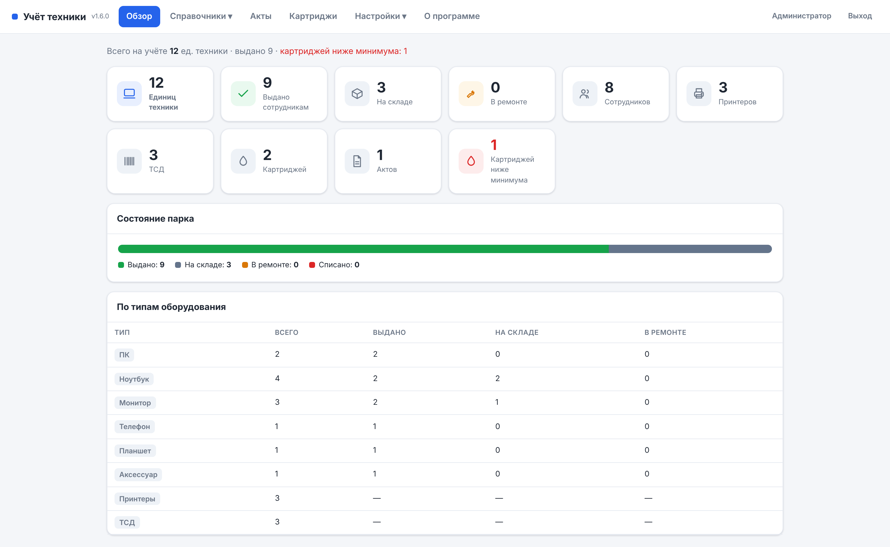
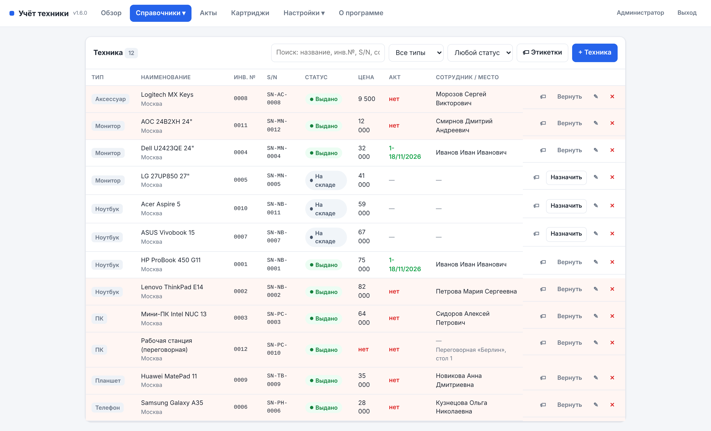

# Учёт техники

**Версия:** 1.8.0

Небольшое веб-приложение для учёта ПК, ноутбуков, мониторов и прочей техники
с привязкой к сотруднику и рабочему месту и печатью **акта приёма-передачи**.

## Скриншоты

Обзор (дашборд):



Список техники:



- **Backend:** FastAPI + PostgreSQL
- **Авторизация:** вход по логину/паролю, сессия в подписанной cookie;
  опциональная **2FA (TOTP)** — Google Authenticator / Authy и совместимые,
  с резервными кодами (вкладка «Данные» → «Безопасность»)
- **Пользователи и права:** несколько учётных записей, роли администратор/
  пользователь, выдача доступа к разделам (техника, сотрудники, акты, картриджи,
  поставщики, ТСД). Проверка прав на сервере, а не только скрытием вкладок
- **Хранение:** PostgreSQL (том `pgdata`)
- **UI:** одностраничный интерфейс, печать актов в PDF прямо из браузера

## Возможности

- Карточки техники: тип, **наименование** (код/модель, напр. `mac-neo-msk-10`),
  **инвентарный №** (порядковый номер, присваивается автоматически), серийный №,
  статус (на складе / выдано / в ремонте / списано), локация, **номер заказа и
  дата покупки**, **стоимость**, примечание.
- **Штрих-код** (Code128) для каждой единицы и **печать этикеток 15×50 мм**
  (наименование + штрих-код + инв. №) — по одной или пачкой для отфильтрованного
  списка. Штрих-код кодирует инвентарный № (или ID, если он пуст).
- Назначение техники **на сотрудника** или **на рабочее место** (без привязки к
  человеку); возврат на склад.
- Справочник сотрудников (**ФИО раздельными полями** — фамилия, имя, отчество),
  карточка сотрудника со всей закреплённой техникой.
- Формирование и печать **акта приёма-передачи материальных ценностей работнику**
  (по форме ИП: наименование, серийный №, ед. изм., кол-во, стоимость и итоговая
  сумма; № акта присваивается автоматически). Реквизиты Работодателя
  (наименование, ИНН, адрес, подписант, основание) настраиваются на вкладке
  «Данные».
- Экспорт/импорт JSON (резервная копия и перенос), экспорт техники в CSV и
  **Excel (XLSX)**.
- **Массовая загрузка техники из Excel** по шаблону (кнопка «Загрузить технику
  (XLSX)» на вкладке «Настройки» → «Данные и резервные копии»). Один лист =
  один тип техники (по названию листа: «Телефоны», «Ноутбуки»…), одна строка =
  одна единица. Колонки: Логин, Имя, Фамилия, Отчество, E-Mail, Внутреннее
  наименование, НАИМЕНОВАНИЕ, Серийный номер, Заказ, Дата покупки, Поставщики,
  Кто выдал, Цена, Локация. Сотрудник находится/создаётся по логину → e-mail →
  ФИО, поставщик — по названию; загрузка **дополняет** базу. Готовый шаблон —
  кнопка «Шаблон».
- **Учёт картриджей:** принтеры, привязанные к ним картриджи с остатком и
  минимальным остатком; приход/расход в один клик. Когда остаток становится
  **≤ минимума**, автоматически уходит уведомление в **Telegram** и/или на
  **E-mail**.
- **Справочник уведомлений:** адресаты (Telegram chat_id + e-mail) — у каждого
  принтера можно задать свой адресат, оповещение уходит в оба канала сразу.
  Транспорт (бот Telegram и SMTP-сервер) и адресат по умолчанию — на вкладке
  «Данные» или через переменные окружения.
- **Справочник ТСД** (терминалы сбора данных): инвентарный номер, наименование,
  внутренний номер, локация.
- **Справочник локаций** — для подстановки в технике, ТСД и принтерах.
- Админские настройки собраны в меню **«Настройки»** (реквизиты для актов,
  транспорт уведомлений, данные и резервные копии, пользователи).
- Вкладка **«О программе»** с версией (константа `APP_VERSION` в `app/main.py`,
  также доступна по `GET /api/version`).
- **Очистка базы** (техника, сотрудники, акты, принтеры, картриджи, поставщики,
  ТСД) с подтверждением паролем; пользователи и реквизиты организации сохраняются.

## Запуск

```bash
cp .env.example .env
# отредактируйте .env: задайте пароли и SECRET_KEY (openssl rand -hex 32)

docker compose up -d --build
```

Интерфейс: <http://localhost:8080> (порт меняется через `APP_PORT`).
Первый вход — логином/паролем из `ADMIN_USER` / `ADMIN_PASSWORD`.
Пароль администратора можно сменить в интерфейсе (кнопка «Пароль»).

При первом запуске база наполняется данными из `app/seed_data.json`
(сотрудники и техника из исходной таблицы). Чтобы начать с пустой базы —
очистите файл до `{"employees":[],"equipment":[]}` перед первым стартом
или удалите том: `docker compose down -v`.

## Обслуживание

```bash
docker compose logs -f app        # логи приложения
docker compose down               # остановить
docker compose down -v            # остановить и удалить данные (том pgdata)
```

Резервная копия базы:

```bash
docker compose exec db pg_dump -U inv inventory > backup.sql
```

Либо через интерфейс: вкладка **Данные → Экспорт JSON**.

Если пользователь потерял доступ к 2FA (телефон и резервные коды), сбросить 2FA
можно напрямую в БД:

```bash
docker compose exec db psql -U inv -d inventory \
  -c "UPDATE users SET totp_enabled=0, totp_secret='', recovery_codes=NULL WHERE username='admin';"
```

## Миграции схемы (Alembic)

Схема БД управляется Alembic. **При каждом старте приложение само применяет
миграции** (`alembic upgrade head`), поэтому обновление — это обычное:

```bash
git pull   # или распакуйте новую версию
docker compose up -d --build
```

Данные не теряются, пересоздавать базу не нужно.

- **Новая база** — создаётся сразу по актуальной схеме.
- **База от прежней версии (создана до Alembic)** — приложение один раз
  добирает недостающие столбцы и помечает схему как актуальную (`stamp head`),
  данные сохраняются.

Создать новую миграцию после изменения моделей в `main.py`:

```bash
docker compose exec app alembic revision --autogenerate -m "описание"
docker compose exec app alembic upgrade head     # или просто перезапустить app
```

Полезное: `alembic current`, `alembic history`, `alembic downgrade -1`.

## Структура

```
inv-tracker/
├─ docker-compose.yml
├─ .env.example
└─ app/
   ├─ Dockerfile
   ├─ requirements.txt
   ├─ main.py            # FastAPI: авторизация, REST API, отдача UI
   ├─ seed_data.json     # стартовые данные (сотрудники + техника)
   ├─ alembic.ini        # конфигурация миграций
   ├─ alembic/           # окружение и версии миграций
   │  ├─ env.py
   │  └─ versions/
   └─ static/
      └─ index.html      # интерфейс
```

## API (кратко)

| Метод | Путь | Назначение |
|------|------|-----------|
| POST | `/api/login` / `/api/login/2fa` / `/api/logout` | вход (2-й шаг — код 2FA) / выход |
| POST | `/api/2fa/setup` `/enable` `/disable` | настройка/включение/отключение 2FA |
| GET  | `/api/2fa/qr.svg` | QR для привязки аутентификатора |
| GET/POST/PUT/DELETE | `/api/users[/{id}]` | пользователи и права (только админ) |
| GET/POST/PUT/DELETE | `/api/notifications[/{id}]` | справочник адресатов уведомлений |
| GET/POST/PUT/DELETE | `/api/locations[/{id}]` | справочник локаций |
| GET  | `/api/me`, `/api/state` | текущий пользователь, всё состояние |
| GET/POST/PUT/DELETE | `/api/equipment[/{id}]` | техника |
| POST | `/api/equipment/{id}/issue` `/return` | назначить (сотрудник/рабочее место) / вернуть |
| GET  | `/api/equipment/{id}/barcode.svg` | штрих-код (SVG, Code128) |
| GET/POST/PUT/DELETE | `/api/employees[/{id}]` | сотрудники |
| POST/DELETE | `/api/acts[/{id}]` | акты |
| PUT  | `/api/settings/org` | реквизиты организации |
| GET/POST | `/api/export` `/api/import` | выгрузка / загрузка JSON |
| GET  | `/api/export/equipment.xlsx` | выгрузка техники в Excel (XLSX) |
| GET/POST/PUT/DELETE | `/api/printers[/{id}]` | принтеры |
| GET/POST/PUT/DELETE | `/api/cartridges[/{id}]` | картриджи |
| POST | `/api/cartridges/{id}/stock` | приход/расход остатка (с проверкой минимума) |
| POST | `/api/cartridges/check` | разослать уведомления по всем позициям ниже минимума |
| GET/PUT | `/api/settings/notify` | настройки уведомлений (секреты маскируются) |
| POST | `/api/settings/notify/test` | тестовая отправка уведомления |
| POST | `/api/wipe` | очистка базы — с паролем |

Автодокументация доступна на `/docs` (Swagger UI).
